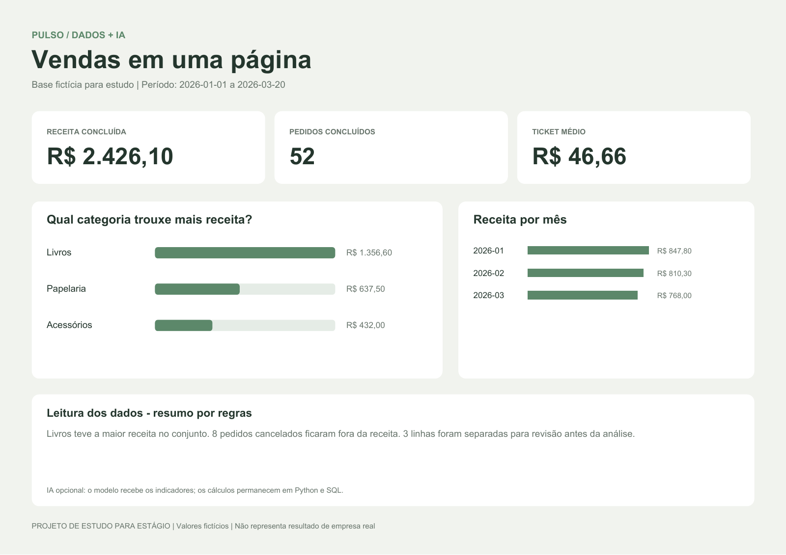

# Pulso

**Transforma uma planilha de vendas em um relatório visual para a equipe comercial.**

Receita, pedidos, ticket médio e categorias em uma página. Python confere a planilha, SQL calcula os indicadores e uma integração opcional com IA ajuda a escrever observações sobre os resultados.



*Saída real do programa. Base fictícia para estudo; o resumo desta imagem foi calculado por regras, sem chamada a um modelo.*

## Um uso simples no dia a dia

Uma equipe comercial recebe um CSV de vendas e precisa conferir os números antes da reunião. O Pulso separa linhas com problemas e produz um PDF que pode ser compartilhado.

| Entrada | O que faz | Entrega |
|---|---|---|
| CSV com pedidos | Confere datas, valores e duplicatas | Base limpa e lista para revisão |
| Pedidos válidos | Calcula indicadores com SQL | Receita, ticket médio e agrupamentos |
| Indicadores calculados | Desenha o relatório | PDF com cartões, gráficos e resumo |
| Indicadores + IA opcional | Sugere observações e perguntas | Rascunho com evidências para revisar |

## Experimentar

Python 3.11 ou superior. Na pasta do projeto:

```powershell
python -m pip install -r requirements.txt
python app.py --pdf --output outputs/vendas
```

Abra `outputs/vendas/sales-report.pdf`. A planilha de exemplo já está incluída: 60 pedidos fictícios e três linhas problemáticas para praticar limpeza. Há 52 pedidos concluídos, oito cancelados e receita de R$ 2.426,10. [Veja o PDF de exemplo](examples/sales-report.pdf).

Para usar outro CSV com o mesmo formato:

```powershell
python app.py --input caminho/vendas.csv --pdf --output outputs/minha-analise
```

Sem `--pdf`, a análise funciona sem instalar pacotes adicionais. Sempre gera `report.md`, `report.json` e `cleaned.csv`. As linhas rejeitadas e os motivos estão no relatório. Outro estudo de dados é o [Ritmo](https://github.com/jcminozzi/ritmo), um chatbot que consulta sua própria base de despesas financeiras.

## Onde entra a IA

```powershell
python app.py --ai --pdf --output outputs/com-ia
```

Configure `OPENAI_API_KEY` e `OPENAI_MODEL` no ambiente, usando um modelo compatível com Structured Outputs. Arquivos `.env` não são carregados automaticamente.

Python e SQL fazem as contas. O modelo recebe somente os indicadores, escreve até três observações e sugere perguntas. Cada observação precisa apontar um indicador existente e copiar sua evidência literal. A IA não altera a base nem os cálculos. O texto completo sai em `ai-notes.md` e `ai-notes.json`; o PDF apresenta uma versão curta.

A verificação de referências não garante a interpretação do texto: revise o rascunho. A integração foi testada com respostas simuladas; a execução com um modelo real ainda precisa ser validada. A demonstração incluída funciona sem API e sem custo de modelo.

## O que estou praticando

- Limpeza de CSV, tratamento de erros e valores monetários em centavos.
- SQL: `SELECT`, `WHERE`, `SUM`, `COUNT`, `GROUP BY` e `ORDER BY`.
- Gráficos e relatório PDF com ReportLab.
- Integração de IA aos resultados e conferência das evidências.
- Testes de duplicatas, cancelamentos, datas inválidas e dados ausentes.

```powershell
python -m unittest discover -s tests -v
```

## Formato da planilha

| Coluna | Exemplo | Significado |
|---|---|---|
| order_id | P001 | Identificador único do pedido |
| date | 2026-01-15 | Data em AAAA-MM-DD |
| category | Livros | Categoria do produto |
| quantity | 2 | Quantidade positiva |
| unit_price | 39.90 | Preço em reais com ponto decimal |
| status | concluida | `concluida` ou `cancelada` |

Cada linha representa um pedido de uma categoria. Cancelamentos ficam fora da receita. A análise usa SQLite em memória, sem servidor. Não calcula lucro, impostos, devoluções ou previsão de vendas. A leitura por mês reflete apenas a base recebida; não há comparação entre períodos completos garantida.

## Próximas melhorias

Praticar a mesma análise com pandas e criar uma tela para selecionar o CSV. Antes disso, conseguir explicar as regras de limpeza, as consultas e a leitura dos gráficos.

Projeto pessoal de João Carlos Minozzi, construído com assistência de IA para estudo e portfólio de estágio. Não representa implantação em empresa.

Referências: [sqlite3](https://docs.python.org/3/library/sqlite3.html) e [Structured Outputs](https://developers.openai.com/api/docs/guides/structured-outputs).

